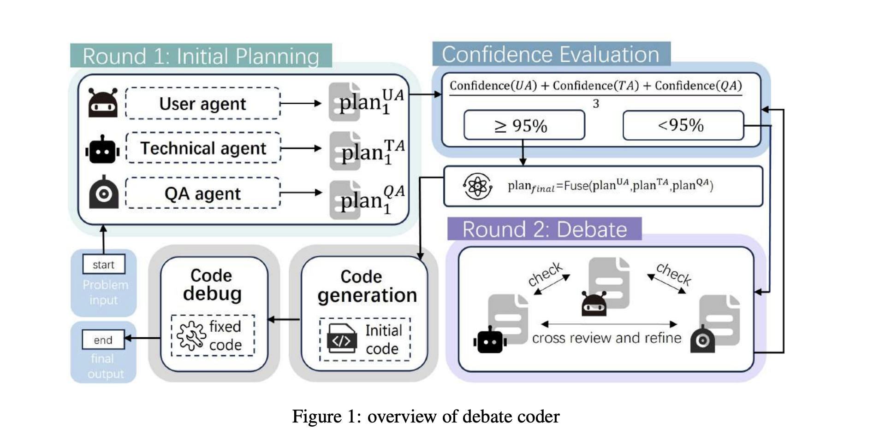

# Debate Gating baseline (confidence-gated debate)

A lightweight, token-efficient **baseline** for comparison with MADAM-RAG; it is not our proposed method. The idea comes from
**DebateCoder** (Zhang et al., *Adaptive Confidence Gating in Multi-Agent
Collaboration for Efficient and Optimized Code Generation*, arXiv:2601.21469,
[PDF](https://arxiv.org/pdf/2601.21469)). We borrow only its **confidence
evaluation mechanism**. The prompts and the rest of the workflow are our own,
written for RAMDocs and TriviaQA.

## What we borrow from DebateCoder



In DebateCoder, several agents each write a plan and report how confident they
are. If their average confidence is high enough (≥ 95%), the debate is skipped
and the plans are fused. Otherwise the agents debate and then score again. Easy
problems therefore stop early and save tokens.

## How we adapt it

Each document gets its own agent, just as in MADAM-RAG. Every round has the same three steps:

1. **Answer + evidence + confidence.** Each agent reads its document and replies:

   ```
   Answer: <short answer, or unknown>
   Evidence: <the sentence from its document that supports the answer>
   Confidence: <0-100>
   ```

   - **Answer** is what gets scored.
   - **Evidence** lets other agents and the fuse step *check* the answer
     instead of trusting it. Two answers backed by sentences about different
     people are both kept (ambiguity). An answer whose sentence is contradicted
     by stronger evidence is dropped (misinformation).
   - **Confidence** drives the gate.

2. **Gate.** Average the confidence of the agents that gave an answer:

   ```
   gate = mean(confidence_i  for agents whose answer is not "unknown")
   ```

   - `gate ≥ 95` → **stop early**: fuse the answers now.
   - `gate < 95` → **debate**: each agent sees the others' answers, evidence,
     and confidences, keeps or revises its answer, and scores again (back to step 2).
   - Agents that answer `unknown` (irrelevant document) are left out of the
     average. If every agent says `unknown`, there is nothing to debate.
   - The debate is capped at `--max-rounds` (default 3).

3. **Fuse.** One call merges the final replies into
   `All Correct Answers: [...]`. It keeps answers about different entities,
   drops contradicted ones, and merges different wordings of the same answer
   (TriviaQA aliases).

**What 95 means.** The prompt gives agents a fixed confidence scale, so the threshold has a concrete meaning:

| Confidence | Meaning given to the agent |
|---|---|
| 95–100 | The document states the answer explicitly, and it clearly matches the question |
| 70–94 | Supported but implied or partial, or the document may be about a different entity |
| < 70 | Weak support, or the document may be wrong |

So `gate ≥ 95` means: *on average, every answering agent found the answer stated
explicitly and unambiguously in its document.* Only then do we skip the debate.
Any hedged agent pulls the average below 95 and triggers a debate.

**What we changed from DebateCoder:**

| DebateCoder | Ours |
|---|---|
| 3 role agents (User, Technical, QA) | One agent per document (1–12 on RAMDocs, 5 on TriviaQA) |
| Plan = how to write the code | Reply = short answer + supporting evidence sentence + confidence |
| Fused plans → code generation → debugging | A single fuse call outputs the final answer list |

**Why it saves tokens:** if a query stops early, it costs `n + 1` calls
(`n` answers plus 1 fuse). MADAM-RAG always runs at least two rounds
(`2n + 1` or more calls). The worst case for our method is `n × max_rounds + 1` calls.

**Caveat:** small models are often overconfident, so the gate may skip
debates it should run. `metrics.json` reports `early_stop_rate` (gate passed in round 1, so the debate was skipped) and
`gate_pass_rate` (gate passed in any round, not just the cap).

The prompts are `ANSWER_PROMPT`, `DEBATE_PROMPT`, and `FUSE_PROMPT` (sharing
`CONFIDENCE_SCALE` and `REPLY_FORMAT`) in `run_debate_gating.py`.

## Datasets

| | Questions | Passages per question | Agents per question |
|---|---:|---:|---:|
| RAMDocs | 500 | 1–12 (mean 5.53) | same as passages |
| TriviaQA (FiD, top 5) | 500 | 5 | 5 |

FiD's TriviaQA has 100 DPR-retrieved passages per question. With one agent per
passage, MADAM-RAG would run 100 document agents per question, about 140 GPU-hours
for 500 questions. That is too expensive, so we keep the **top 5 passages by DPR
retrieval rank**, the same cutoff for every method.

Of the original seed-42 sample, 24% (118/500) had no answer string in their top 5. So we
kept drawing (seed 42) and kept only questions with the answer in at least one of
their top 5 passages (`data/triviaqa_top5/`). On average 3.3 of the 5 passages
contain the answer, and the rest are distractors, so the debate still has noise to
filter. 28% of questions have the answer in all 5 passages, and 16% in only one. With
this setup, MADAM-RAG on TriviaQA costs about the same as on RAMDocs.

## Running (SiliconFlow API)

Put `SILICONFLOW_API_KEY=...` in `.env` at the repository root (gitignored) or
export it. Then, from the repository root:

```bash
bash scripts/run_debate_gating_baseline.sh --limit 5   # smoke test: 5 questions from each dataset
bash scripts/run_debate_gating_baseline.sh             # full run: both datasets, 500 + 500
```

**Experiment settings** (all saved in `manifest.json`):

| Setting | Value |
|---|---|
| API | `https://api.siliconflow.com/v1` (OpenAI-compatible) |
| Model | `Qwen/Qwen3-8B`, the same backbone as the local baselines |
| Temperature | 0.0 (greedy), seed 42, as in the local baselines. Change with `--temperature` |
| Thinking | Off (`enable_thinking=false`), matching the local non-thinking baselines. Turn it on with `--enable-thinking --thinking-budget N --max-new-tokens M` (M must be larger than N, because thinking tokens count toward the output limit) |
| Max new tokens | 128 per call |
| Gate | Threshold 95, at most 3 rounds |
| Price | $0.06 / 1M input and $0.06 / 1M output tokens (SiliconFlow list price, Oct 2026). Change with `--input-price` / `--output-price` |

**Parallel workers.** The run script picks the concurrency from the machine
before it starts:

- Each request mostly waits on the network, so CPU is not the bottleneck.
- On this Raspberry Pi 5 (4 cores, 8 GB RAM), 32 concurrent HTTPS requests added only about 33 MB.
- The script keeps 1.5 GB of RAM free for the OS and budgets 8 MB per in-flight request.
- It caps in-flight requests at 6 (3 questions at a time) to stay under SiliconFlow's rate limit. With 16 requests in flight, the first full run hit HTTP 429 hundreds of times. Any 429 is retried with backoff that honors `Retry-After`.
- It halves the concurrency if the load average is already at or above the core count.
- The question-worker count is half the request cap, because each question sends several agent calls at once.
- Python runs under `nice` so SSH and other services stay responsive.

Override with `WORKERS=... MAX_CONCURRENCY=... bash scripts/run_debate_gating_baseline.sh`. See [SILICONFLOW_NOTES.md](SILICONFLOW_NOTES.md) for measured throughput and 429 rates at different settings.

**Results folder:** `baselines/DebateGating/results/Qwen3-8B/<dataset>/debate_gating/`
(`Qwen3-8B-limitN/` for `--limit N` runs, so a smoke test never mixes with the full run)

- `manifest.json`: the configuration, plus each session's start/end time, wall time, and worker settings.
- `predictions.jsonl`: per query: each round's agent replies (answer, evidence, confidence) and gate score, every call (tokens, cost, latency, finish reason), `cost_usd`, `query_seconds`. It is resumable; rerun the same command to continue.
- `metrics.json`: the same accuracy/F1/token metrics as the other baselines, plus `early_stop_rate`, `gate_pass_rate`, `total_cost_usd`, `mean_cost_usd`, `mean_query_seconds`, `wall_seconds`, `mean_reasoning_tokens`.
- `../../logs/run-*.log`: console log of each run.

API serving may not be exactly deterministic, and token counts are the
provider-reported usage. So compare with the local vLLM baselines with care.

Unit tests (CPU only, with no API calls) are in `baselines/test_baselines.py`:

```bash
python -m unittest baselines.test_baselines -v
```
